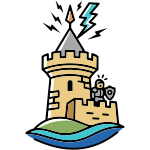

---

# Herald Messaging Frameworks 2.0



Herald is a messaging framework for Java services. A service does not open a broker connection or
build a client of its own. It asks one facade for a named bus and gets back an object that sends and
receives. Which broker carries the messages is set in configuration, not in code.

**The buses are declared once, in one catalog.** Every bus a fleet of services uses is listed in one
topology file. A service names the bus it needs and its role on it. Adding a broker is one jar on the
classpath and one setting.

**Esquire is built on it.** Esquire's entity updates, its user commands to the identity server, and
its audit trail all run on Herald.

The cost is one more layer between the service and the broker. A feature the broker has and the bus
does not expose is not available to the service.

---
>
> **v2.0.0 -- the first release.** The framework was part of Esquire until now, in the services
> repository. It keeps its history in the release notes. See [Release History](#release-history).
> The configuration keys still start with `esquire`; a later release names them after Herald.

---

## Installation

Java 24 and Maven. Herald builds on [Armoury](https://github.com/mir0n-pro/armoury): install Armoury
first.

```
mvn clean install
```

This builds the jars and installs them into the local Maven repository:

| Maven coordinates | What it is |
|---|---|
| `pro.mir0n:herald-messaging:2.0.0` | The framework: the facade, the catalog, the x-rod engine, and the transport interface |
| `pro.mir0n:herald-dataKeep:2.0.0` | The keep: writes what the bus carries into a database |
| `pro.mir0n:herald-tp-activemq:2.0.0` | The transport for ActiveMQ: queues and topics |
| `pro.mir0n:herald-tp-kafka:2.0.0` | The transport for Kafka: topics |
| `pro.mir0n:herald-tp-redis:2.0.0` | The transport for Redis Streams: sending only |
| `pro.mir0n:herald-tp-sqns:2.0.0` | The transports for Amazon SQS (queues) and Amazon SNS (topics) |
| `pro.mir0n:herald-tp-kinesis:2.0.0` | The transport for Amazon Kinesis: streams |

---

## Project Structure

| Project | Description |
|---|---|
| [messaging](messaging) | The framework: the bus facade, the catalog, the x-rod engine, the transport interface, and the message codec |
| [dataKeep](dataKeep) | A receiver that writes each message into a database, with its SQL kept in resource files |
| [tp-activemq](tp-activemq) | The ActiveMQ transport |
| [tp-kafka](tp-kafka) | The Kafka transport |
| [tp-redis](tp-redis) | The Redis Streams transport |
| [tp-sqns](tp-sqns) | The Amazon SQS and Amazon SNS transports |
| [tp-kinesis](tp-kinesis) | The Amazon Kinesis transport |

---

## Release History

**[release_notes.txt](doc/release_notes.txt)** -- the release notes, newest first.

---

## Documentation

### Architecture & Design
- [Messaging Bus -- the framework reference](doc/Herald.MessagingBus.md) *(the bus model, the x-rod
  engine, the parameter model, the transport interface, and every transport's parameters)*
- [Message structure](doc/Herald.MessagingBus.MessageStructure.md) *(the fields of every message
  type on the wire)*
- [Design Q&A](doc/Herald.MessagingBus.Q&A.md) *(behavior that looks like a defect, and why each one
  is deliberate)*

### Guides
- [Guides](doc/Herald.MessagingBus.Guides.md) *(getting started, moving a JMS or Kafka caller onto
  the bus, tuning and sizing)*

### Continuing development
- [Continuing development](doc/Herald.MessagingBus.ContinuingDev.md) *(the open work, one item at a
  time)*

---

## Products

<table style="width: 100%; table-layout: fixed;">
  <tr></tr>
  <tr><td style="width: 100%;">
    <b>herald-messaging</b>
    <br>The framework. A service asks the <code>MessagingBus</code> facade for the x-rod of a named bus,
       and the framework builds the rest from the catalog.
       <br> - <code>pro.mir0n.messaging</code> -- the facade, the event, and the health indicators.
       <br> - <code>pro.mir0n.messaging.catalog</code> -- the catalog: buses, slots, nodes, and roles.
       <br> - <code>pro.mir0n.messaging.xrod</code> -- the x-rod engine: one sending leg and one receiving
         leg per x-rod, for broadcast, for request and response, and for in-process delivery.
       <br> - <code>pro.mir0n.messaging.transport</code> -- the transport interface,
         <code>ITransportProvider</code>. The framework names no broker; each transport is a jar of its own.
       <br><br>It needs Armoury utils and Jackson. Spring Boot and SLF4J are at <code>provided</code> scope:
         the application brings them.
  </td></tr>

  <tr><td style="width: 100%;">
    <b>herald-dataKeep</b>
    <br>A receiver that writes each message it gets into a database. The SQL is not in the code: it
       sits in a resource file per database, so a new database is a new file. A director class, named in
       the configuration, says which statement handles which kind of message.
       <br><br>It runs in the same process as the service, on its own connection pool. Postgres and
       Oracle drivers ship with it.
  </td></tr>

  <tr><td style="width: 100%;">
    <b>herald-tp-*</b>
    <br>One transport per broker: ActiveMQ, Kafka, Redis Streams, Amazon SQS and Amazon SNS, and Amazon
       Kinesis. A service carries only the transports it uses. The ActiveMQ, Kafka, and Redis transports
       also stop Spring Boot from setting up the broker client on its own: it stays idle until the bus
       asks for it.
       <br><br>The Redis transport sends and does not receive.
  </td></tr>
</table>

---

## License

GNU General Public License v3.0. See [LICENSE](LICENSE).
